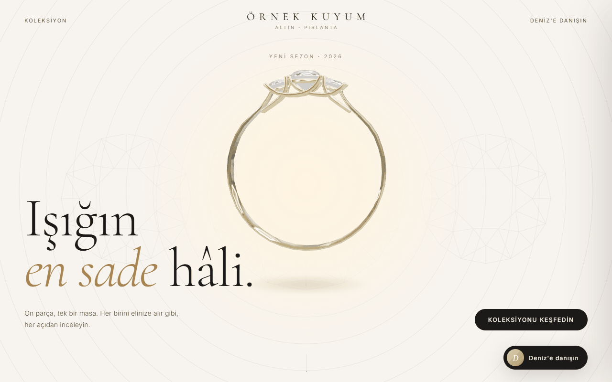
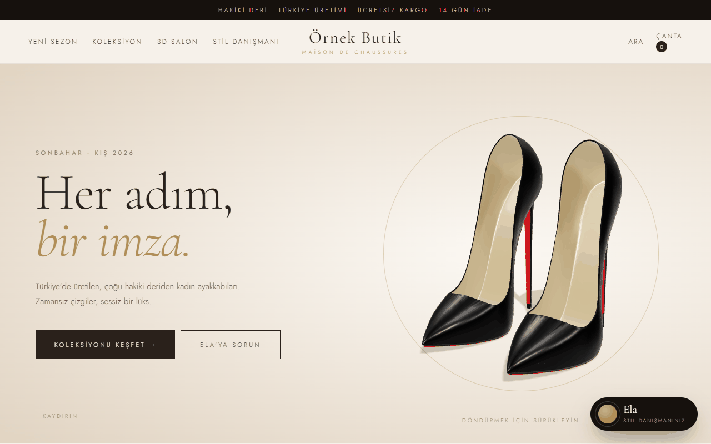

# Yapay Zekâ Destekli Mağaza Asistanları

> **EN summary:** AI shopping and booking assistants built for real small businesses (fashion, shoe boutique, jewelry with a 3D showcase, beauty salon), with brand names anonymized. A tool-calling LLM searches the catalog, adds to cart and books appointments; each project has contract tests that check the assistant's rules without calling the API. Full English version: [README.en.md](README.en.md).

Küçük bir mağazada satışın çoğu sohbetle oluyor: "bu elbisenin M bedeni var mı?", "boyum 1,65, hangi bedeni alayım?", "bu kolyenin bakımı nasıl yapılır?". Bu soruları gece yarısı da cevaplayabilen, ürünü gösterip sepete ekleyebilen asistanlı siteler yaptım. Her biri gerçek bir işletme için hazırlandı. Bu repoda marka adlarını (Örnek Moda, Örnek Butik, Örnek Kuyum, Örnek Güzellik), adresleri ve iletişim bilgilerini değiştirdim.

 

**Canlı:** [3D kuyum vitrini](https://emirhnnnk-lab.github.io/ai-magaza-asistanlari/3-kuyum-3d-vitrin/)

| # | Proje | Sektör | Asistan ne yapıyor |
|---|---|---|---|
| 1 | [Moda Stil Danışmanı](1-moda-stil-danismani) | Kadın giyim, internet satışı | **Defne**: ürünleri görselli kartlarla gösteriyor, boy ve kiloya göre beden öneriyor, kombin kuruyor, sohbetten sepete ekliyor |
| 2 | [Butik Ayakkabı Asistanı](2-butik-ayakkabi-asistani) | Ayakkabı butiği | Katalogdan ürün öneriyor, stok ve beden soruyor; cevaplayamadığı soruyu Telegram'dan ekibe iletiyor |
| 3 | [Kuyum 3D Vitrin](3-kuyum-3d-vitrin) | Kuyumculuk | Three.js ile 3D ürün vitrini; ürün ve bakım sorularını cevaplayan asistan |
| 4 | [Güzellik Randevu Asistanı](4-guzellik-randevu-asistani) | Güzellik merkezi | Hizmet danışmanlığı, randevu önerisi, müşteri ve yönetim panelleri |

## Ortak yapı ve kararlarım
- **Asistan gerçek iş yapıyor:** model sadece sohbet etmiyor; araçlar üzerinden katalogda arıyor, sepete ekliyor, randevu öneriyor (OpenAI API, araç çağırma).
- **Asistanın kuralları test ediliyor:** her projede asistanın uyması gereken kurallar yazılı ve bunları **modeli hiç çağırmadan** kontrol eden sözleşme testleri var (`contract-test.js`). Örneğin katalogda olmayan bir ürünü önermemek gibi. Böylece bir değişiklik yaptığımda kuralı bozup bozmadığımı ücretsiz ve saniyeler içinde görebiliyorum.
- **Model erişilemezse de çalışıyor:** kuyum vitrini modele ulaşamazsa kendi kural tabanlı asistanıyla devam ediyor; müşteri boş ekranla karşılaşmıyor.
- **Sade kurulum:** sunucu ek paket gerektirmeyen düz bir Node.js sunucusu; önyüz düz JavaScript, CSS ve 3D için Three.js.

## Çalıştırma
Her klasörde:
```bash
# kök klasöre .env dosyası: OPENAI_API_KEY=...
node server.js        # Moda Stil Danışmanı için: node demo/server.js
```

## Notlar
- Ürün görselleri işletmelerin izniyle kullanıldı ve repoda yerel olarak duruyor. Moda Stil Danışmanı'nda katalogdan 40 ürünlük bir bölüm var; butikte görseli olmayan ürünler yer tutucuyla gösteriliyor.
- 3D modeller (.glb) ticari kullanıma açık lisanslı kaynaklardan alındı; telif ve atıf hakları sahiplerine ait.

---
Geliştiren: **Emirhan Karaca**
